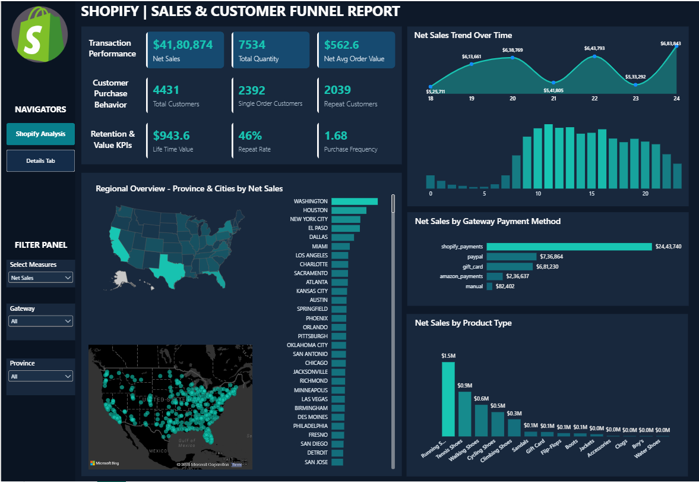
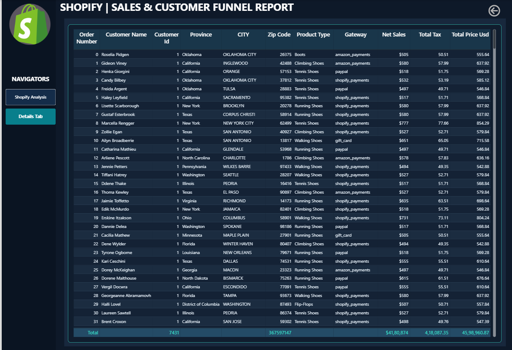

# 🛍️ Shopify Sales & Customer Funnel Analytics Dashboard

## 📌 Executive Summary

This project delivers a comprehensive Power BI analytics solution designed to evaluate Shopify sales performance, track customer funnel retention dynamics, and optimize e-commerce revenue operations. By analyzing key commercial metrics across time, payment gateways, product categories, and geographic regions, this dashboard empowers business stakeholders to monitor net sales, average order value, repeat purchase behavior, and granular transaction records through interactive drill-through navigation.

---

## 🛠️ Tools & Technologies Used

* **Data Visualization & Dashboarding:** Power BI Desktop (DAX measures, interactive filter panel, drill-through pages, custom page navigation, dark executive theme)
* **Data Processing & Analytics:** Microsoft Excel (`Shopify Sales.xlsx`) & Power Query
* **Documentation & Presentation:** Markdown & GitHub Portfolio

---

## 📊 Dashboard Showcase & Page Breakdown

### Page 1: Shopify Analysis (Executive Overview)

> *Comprehensive executive funnel view featuring core KPI cards across Transaction Performance ($41,80,874 Net Sales, 7,534 Total Quantity, $562.6 Net AOV), Customer Purchase Behavior (4,431 Total Customers, 2,392 Single Order, 2,039 Repeat Customers), and Retention & Value KPIs ($943.6 LTV, 46% Repeat Rate, 1.68 Purchase Frequency), alongside Net Sales trends, regional U.S. maps, payment gateway mix, and product category breakdowns.*

### Page 2: Details Tab (Drill-Through Order & Customer View)

> *Granular transaction-level inspection table powered by Power BI's **drill-through** feature, allowing users to right-click any metric or segment on the main dashboard to filter and audit individual Order Numbers, Customer Names, Customer IDs, Provinces, Cities, Zip Codes, Product Types, Payment Gateways, Net Sales, Total Tax, and Total Price (USD).*

---

## 💡 Key Analytical Insights

* **Revenue & Order Performance:** Generated **$41,80,874** in Net Sales across **7,534** units and **4,431** unique customers, maintaining a strong **$562.60** Net Average Order Value.
* **Customer Retention Strength:** Nearly half of the customer base (**46%** repeat rate, **2,039** repeat buyers) returns for additional purchases, driving a **1.68** purchase frequency and **$943.60** Customer Lifetime Value.
* **Payment Gateway Dominance:** `shopify_payments` accounts for the largest share of revenue at **$24,43,740**, significantly outperforming `paypal` ($7,36,864), `gift_card` ($6,81,230), and `amazon_payments` ($2,36,637).
* **Top-Performing Product Lines:** **Running Shoes** leads all product categories (approx. **$1.5M**), followed by **Tennis Shoes** (approx. **$0.9M**) and **Walking Shoes** (approx. **$0.6M**).

---

## 🚀 How to View This Project

1. Download the `.pbix` file (`Shopify_Analysis_Dashboard.pbix`) and dataset (`Shopify Sales.xlsx`) from this repository.
2. Open `Shopify_Analysis_Dashboard.pbix` in **Power BI Desktop** to interact with the dynamic filter panel (Measure selector, Gateway, and Province slicers), custom page navigators, and right-click drill-through functionality locally.
